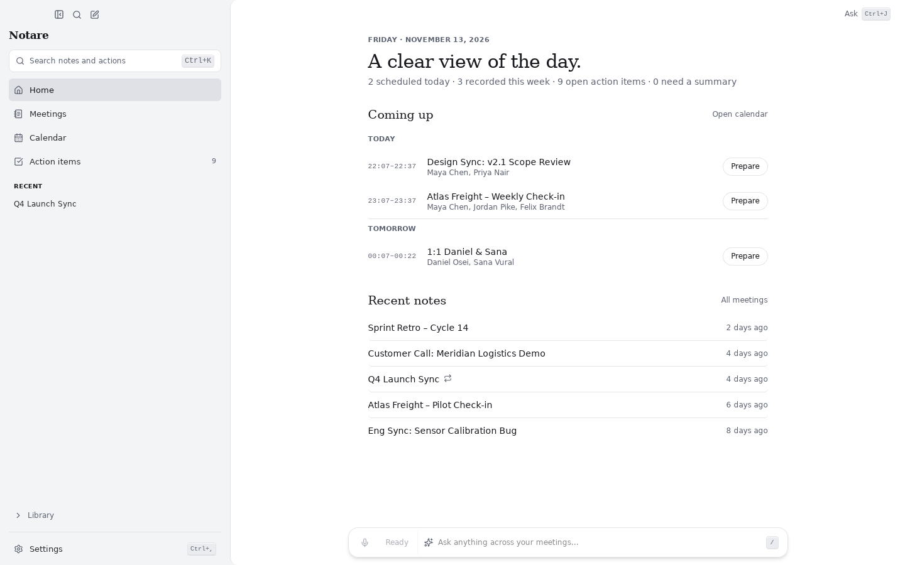
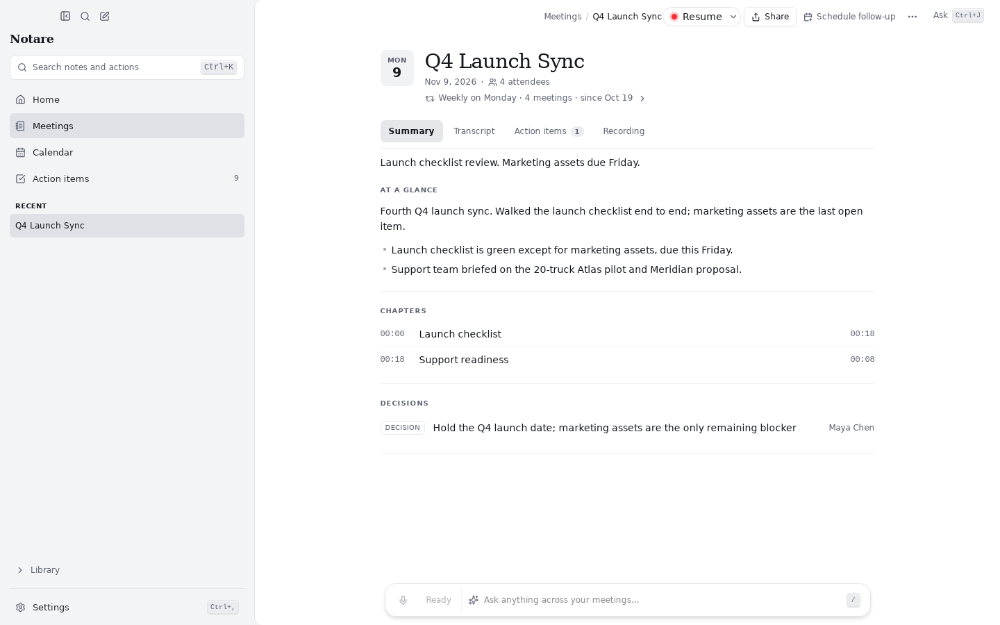
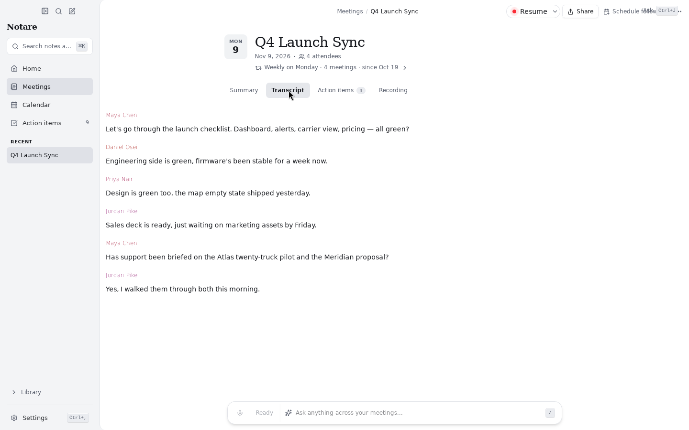
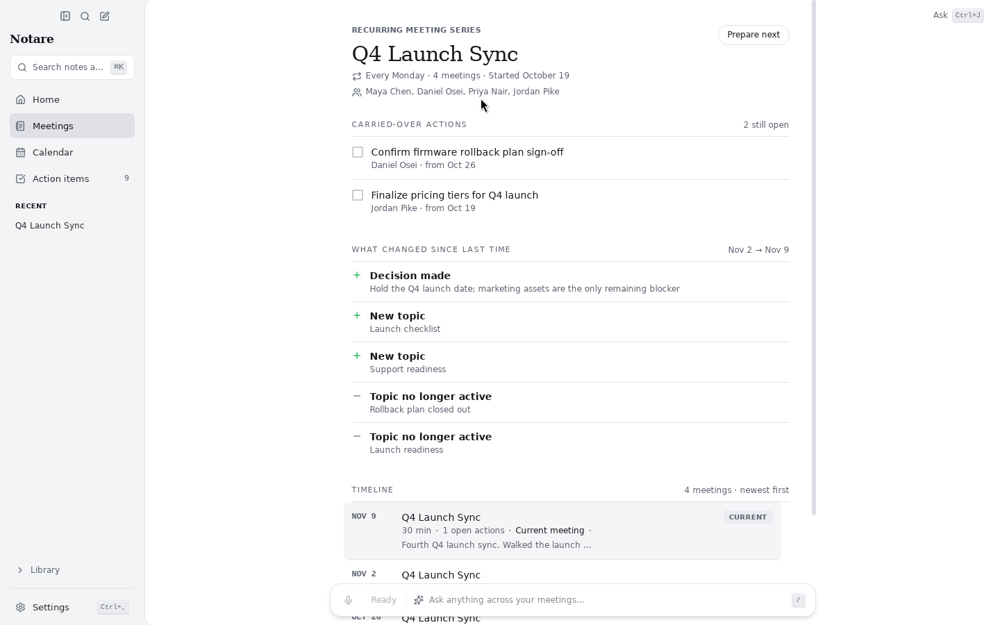
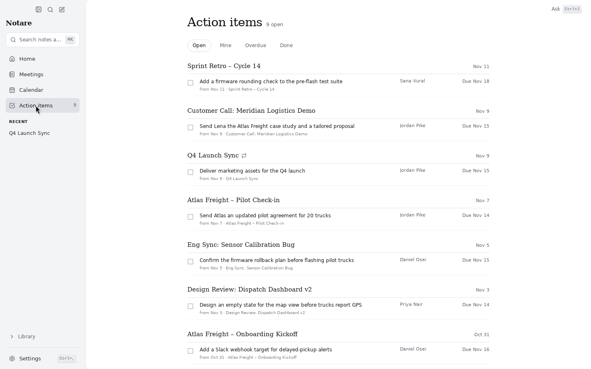
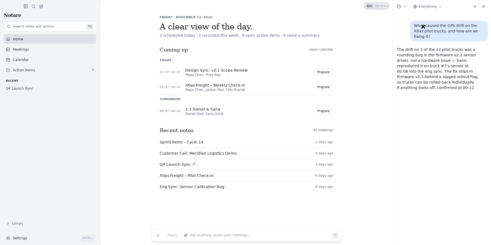
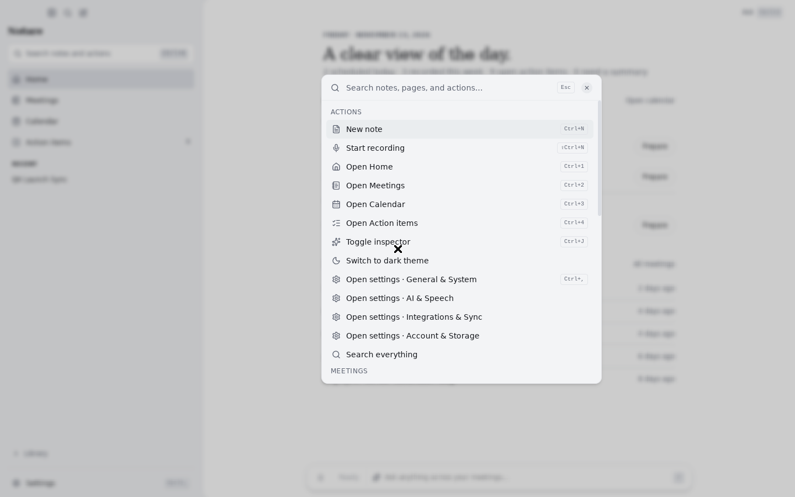
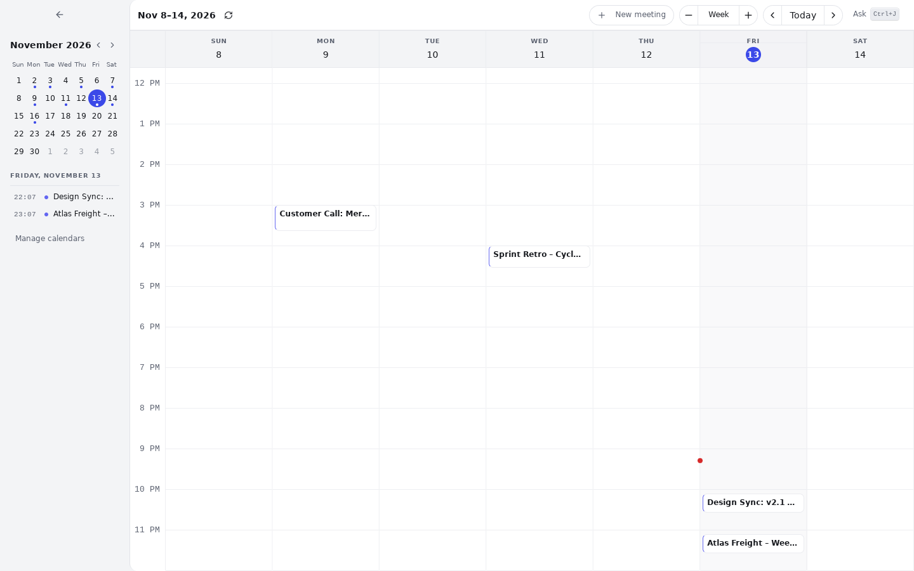
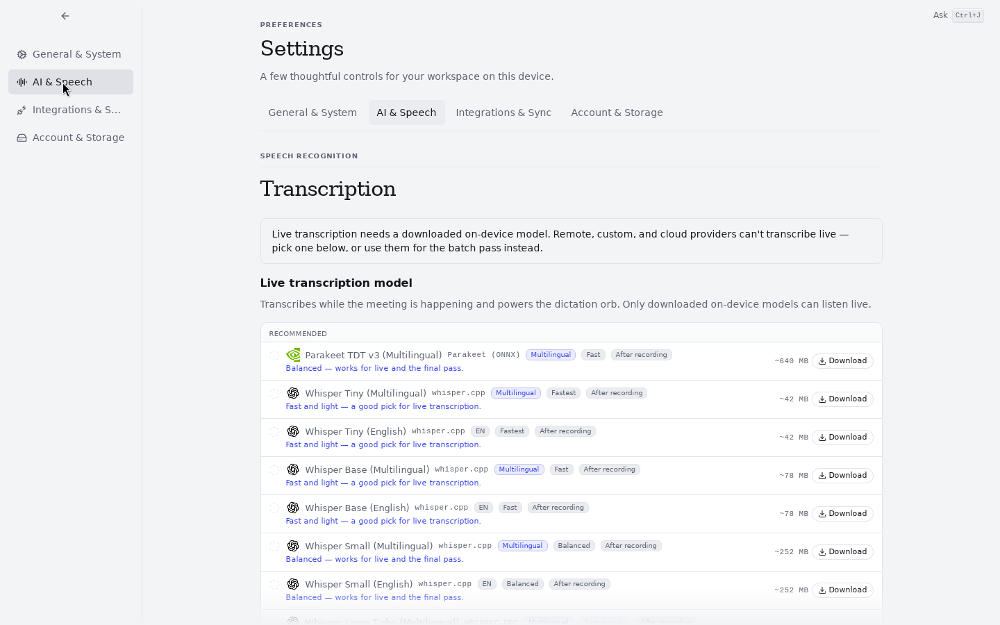
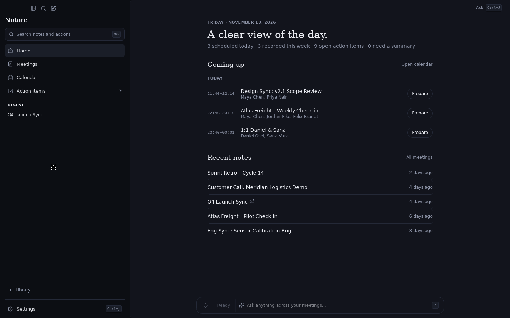

# Notare

**Open-source, local-first meeting notetaker + push-to-talk dictation for Windows, macOS, and Linux.**

Notare records your meetings **locally** (system audio + microphone — no bots
join your calls), transcribes them live on your GPU with whisper.cpp, and uses
the transcript to *enhance the rough notes you actually typed* — notepad-first,
not summary-slop-first. Everything lands as plain Markdown in any folder you
choose, so your Obsidian vault (or any notes app) is the database.

Hold a hotkey anywhere and it's also a system-wide **dictation** tool: speak,
release, and the text is typed into whatever app has focus.

🌐 [notare.dev](https://notare.dev) · [Download](https://github.com/abhi-wan-kenobi/notare/releases/latest) · [What's new in 0.7](packages/changelog/content/0.7.0.md)

## Download

Grab the latest installer from **[GitHub Releases](https://github.com/abhi-wan-kenobi/notare/releases/latest)**:

| Platform | File |
|---|---|
| Windows 10/11 (x64) | `.msi` |
| Linux (x64) | `.AppImage` or `.deb` |
| macOS (Apple Silicon) | `.dmg` — signed and notarized |

Auto-updates are built in on **Windows (`.msi`)**, **macOS (`.dmg`)**, and the
**Linux `.AppImage`** — install once and the app keeps itself current. The Linux
**`.deb`** cannot self-update (the in-app updater is AppImage-only on Linux); it
detects this and points you to Releases instead of failing — update it with
`apt install ./Notare_<version>_amd64.deb` (or your package manager) when a new
version ships.

> **Windows SmartScreen:** builds are not (yet) code-signed, so SmartScreen
> will warn on first run. Click **More info → Run anyway**.

> **macOS:** builds are signed with a Developer ID and notarized by Apple, so
> they open normally. Apple Silicon only — Intel Macs: build from source.

## Highlights

| | |
|---|---|
| 🎙️ **Meeting mode** | Captures system + mic audio locally; live transcription; no bot joins your call |
| 🏠 **Home** | Today's meetings with *Open notes* / *Prepare*, what you recorded this week, open action items, and notes that still need a summary |
| 🧭 **Meeting page** | Summary · Transcript · Action items · Recording. Chapters you can click to jump the recording, plus the decisions that were made |
| 🔁 **Recurring meetings** | Notare recognises a series: action items carried over from earlier occurrences, what changed since last time, and a timeline of every occurrence |
| ⚡ **GPU transcription** | whisper.cpp with Vulkan (AMD/Intel/NVIDIA) — fast local STT on Windows *and* Linux |
| ⌨️ **Dictation mode** | Push-to-talk anywhere; text is typed at your cursor, with output cleanup options |
| 📝 **Notepad-first AI** | Your rough notes enhanced with transcripts — pre-meeting briefs, 25-template gallery, and follow-up email drafts |
| 💬 **Ask Notare** | A side panel (⌘J / Ctrl+J) that searches across meetings with scope filters, clickable timestamp citations, and slash recipes |
| ⌨️ **Command palette** | ⌘K / Ctrl+K for actions, meetings, and recipes |
| 🧠 **Flexible AI setup** | Local offline models (Ollama/LM Studio), BYO API keys, official OpenRouter sign-in, subscriptions (Claude/ChatGPT/Gemini), or omp gateway |
| 📁 **Plain Markdown** | Notes written straight into any folder — point it at your Obsidian vault |
| 📅 **Calendar & Email** | One-click Google & Outlook multi-account sync; opt-in Gmail follow-up drafts |
| 🤖 **MCP server** | Built-in streamable HTTP & stdio bridge for Claude Desktop, Cursor, and agents |
| 🔄 **Device sync (preview)** | Direct peer-to-peer sync with QR pairing and 6-digit code confirmation |
| 🖥️ **Companion STT server** | Optional Docker server (CPU, Vulkan, NVIDIA CUDA, AMD ROCm images) with an OpenAI-compatible `/v1/audio/transcriptions` API and web model admin |
| 🔒 **Zero telemetry** | Analytics compiled out at build time; no accounts; nothing leaves your machine unless *you* configure a remote backend |
| 🪪 **MIT licensed** | Fork-friendly, forever |

## Screenshots

Captures of the 0.7.1 build on Linux with fictional demo data.

| | |
|---|---|
|  **Meeting page** — your notes, the summary at a glance, chapters, decisions |  **Transcript** — speakers and timestamps |
|  **Recurring series** — carried-over action items and every occurrence |  **Action items** — everything open, grouped by meeting |
|  **Ask Notare** — ask across your meetings |  **Command palette** — ⌘K / Ctrl+K |
|  **Calendar** — week view with a mini month |  **Settings** — four hubs |

Dark theme is one toggle away:

## Principles

- **Local-first, privacy-first.** Audio and transcripts never leave your machine
  unless *you* configure a remote backend. No telemetry, period. No accounts.
- **BYO everything.** Your own STT models (HuggingFace), your own LLM endpoint,
  your own Google OAuth client for calendar. No hosted service, no lock-in.
- **Plain Markdown output.** Your notes vault is the database.
- **Never trust a flag over the filesystem.** Model state is reconciled against
  on-disk reality (checksum-verified) on every launch; corrupt models are
  quarantined automatically.

## Roadmap

Development is planned in the open. See the
[Notare Roadmap board](https://github.com/users/abhi-wan-kenobi/projects/1)
for what's up next, or browse the
[milestones](https://github.com/abhi-wan-kenobi/notare/milestones)
and the [issue tracker](https://github.com/abhi-wan-kenobi/notare/issues).
Feature requests and bug reports are welcome — issues labeled
[`help wanted`](https://github.com/abhi-wan-kenobi/notare/labels/help%20wanted)
are great places to jump in.

## Build from source

See [`docs/BUILDING.md`](docs/BUILDING.md). Short version: Rust + pnpm +
Tauri v2; `pnpm install && pnpm -F desktop tauri build`. Intel-Mac users must
build from source for now — released macOS builds are Apple Silicon only.

## Lineage & credits

Notare is a friendly MIT fork of **[anarlog](https://github.com/fastrepl/anarlog)**
(which started life as **Hyprnote**) by [Fastrepl](https://github.com/fastrepl) —
an excellent local-first notetaker whose audio-capture and session core this
project builds on. Headline additions over upstream: **shipped Windows and
Linux support**, a unified **dictation mode**, a rebuilt self-healing **model
manager**, and the **companion GPU STT server**.

Further inspiration: [Meetily](https://github.com/Zackriya-Solutions/meeting-minutes)
(meeting-capture UX), [Handy](https://github.com/cjpais/Handy) and
[OpenWhispr](https://github.com/OpenWhispr/openwhispr) (dictation), and the
voice-orb visualisation crowd.

More background: [`docs/PROJECT-BRIEF.md`](docs/PROJECT-BRIEF.md) and
[`docs/adr/`](docs/adr/) for architecture decisions.

## Sponsor

Notare is free and stays free. Sponsorship covers what shipping it actually costs: Apple
Developer membership, code-signing certificates, and the hours to keep three platforms'
release pipelines working.

**Current goal — a Windows code-signing certificate.** Windows installers are unsigned
today, so SmartScreen warns people the app might be dangerous. Signing removes that
warning for every Windows user.

[Sponsor this work](https://github.com/sponsors/abhi-wan-kenobi) · [SPONSORS.md](SPONSORS.md)

## License

[MIT](LICENSE) — including upstream anarlog code (MIT, Fastrepl, Inc.).
See [`docs/LICENSE-NOTE.md`](docs/LICENSE-NOTE.md) for full license diligence,
including per-model licenses in the STT catalog.
